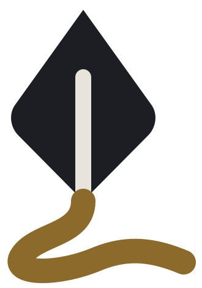
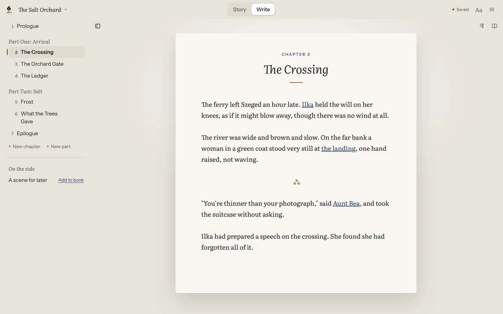
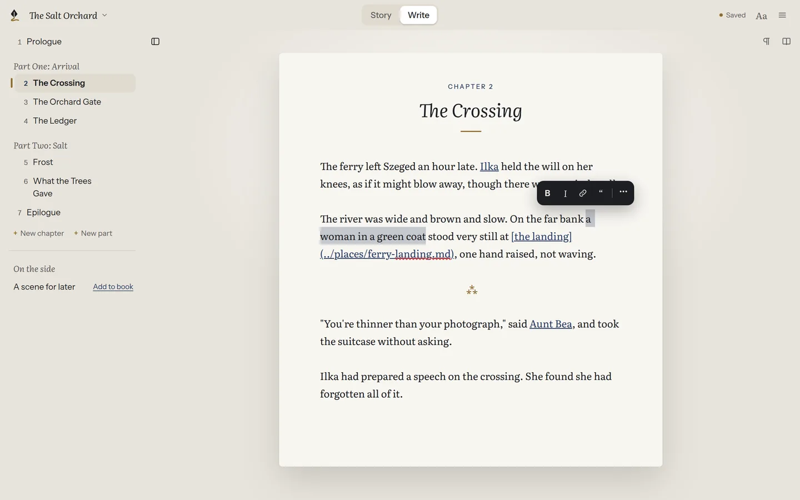
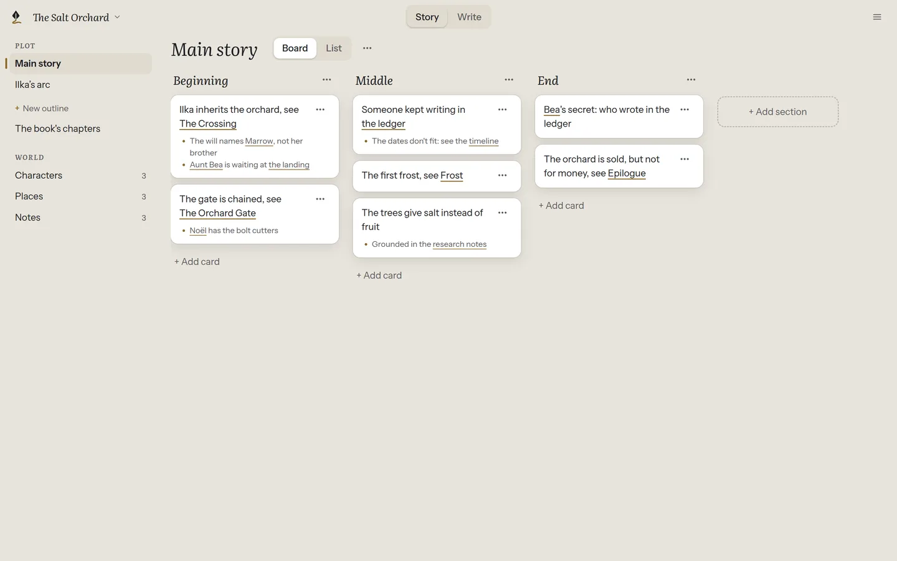
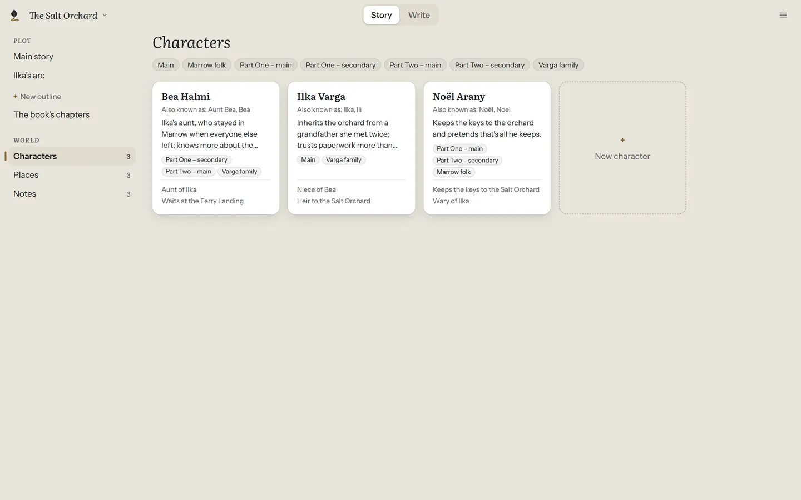
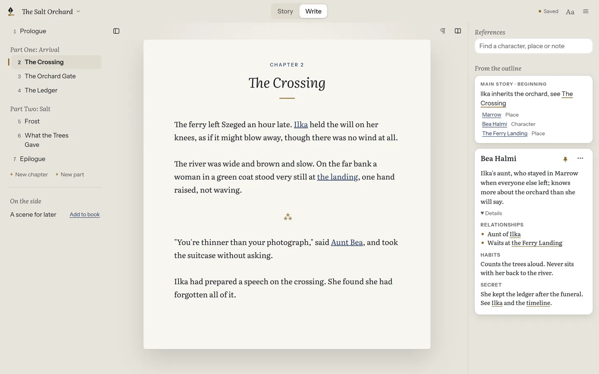
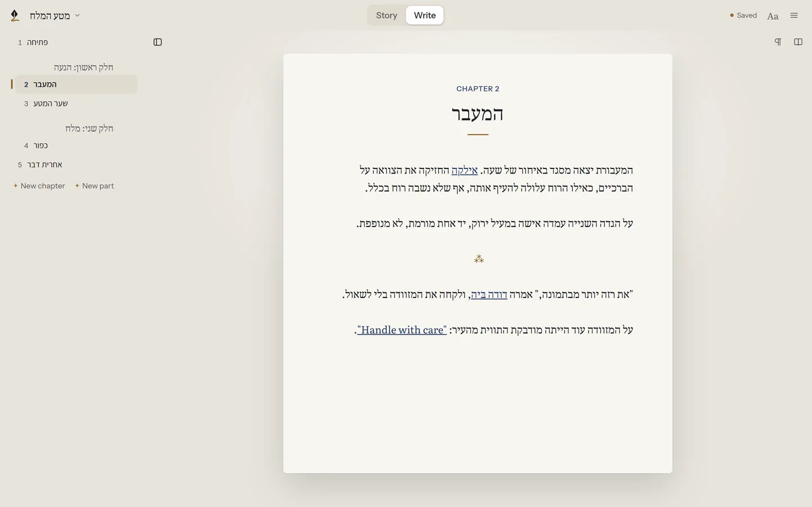

<p align="center">
  <picture>
    <source media="(prefers-color-scheme: dark)" srcset="apps/site/src/assets/mark-dark.svg">
    
  </picture>
</p>

<h1 align="center">Plot Device</h1>

<p align="center"><strong>Write the novel. Keep the files.</strong><br>
A calm writing studio for novelists, in English and Hebrew.</p>

<p align="center">
  <a href="https://github.com/mooeypoo/plotdevice/actions/workflows/ci.yml"></a>
  <a href="https://mooeypoo.github.io/plotdevice/"></a>
  <a href="LICENSE"></a>
  <a href="https://buymeacoffee.com/mooeypoo"></a>
</p>

<p align="center">
  <a href="https://github.com/mooeypoo/plotdevice/releases"><strong>Download</strong></a> ·
  <a href="https://mooeypoo.github.io/plotdevice/">Read the guide</a> ·
  <a href="https://mooeypoo.github.io/plotdevice/he/">המדריך בעברית</a>
</p>

<picture>
  <source media="(prefers-color-scheme: dark)" srcset="assets/readme/desk-dark.webp">
  
</picture>

Plot Device is a desktop app for writing a novel. It gives you a quiet page to write on, a clear view of your story while you plan it, and keeps the whole book as an ordinary folder of Markdown files that you can open in any other app, back up however you like, and keep for good.

It is in **early versions for Linux and Windows**; macOS will come later. It needs no account and no internet connection.

## What it does

### Write first

Open a chapter and write. There's no outline to fill in and no setup. Formatting appears only when you select text, and the rest of the app stays out of your way.

<picture>
  <source media="(prefers-color-scheme: dark)" srcset="assets/readme/formatting-dark.webp">
  
</picture>

### See the story

Plan in outlines that are simply Markdown lists, shown as a board or a list, or typed freely as text. Drag a card, link it to a chapter or a character, and your prose stays exactly as you wrote it.

<picture>
  <source media="(prefers-color-scheme: dark)" srcset="assets/readme/story-dark.webp">
  
</picture>

### Keep your world close

Characters, places and notes live in the book too, with tags to group them. While you write, they sit beside the page: search, pin the ones you need, and never lose your place in the chapter.

<picture>
  <source media="(prefers-color-scheme: dark)" srcset="assets/readme/world-gallery-dark.webp">
  
</picture>

<picture>
  <source media="(prefers-color-scheme: dark)" srcset="assets/readme/references-dark.webp">
  
</picture>

### Multilingual

The interface in your language, the book in its own. Plot Device speaks English and Hebrew today, right to left included, and is built to take more languages: each new one is a translation, not a rewrite. Write a Hebrew novel with English names, or an English one in a Hebrew interface: every paragraph runs the right way, and punctuation lands where it belongs. Want Plot Device in your language? [Help translate it](https://mooeypoo.github.io/plotdevice/about/translate/).

<picture>
  <source media="(prefers-color-scheme: dark)" srcset="assets/readme/bilingual-dark.webp">
  
</picture>

### Your files, yours for good

Every chapter is a Markdown file, the book's order is a readable list, and outlines are ordinary lists. Open the same folder in Obsidian, a text editor or git: Plot Device is a lens on your files, not a place that locks them in. Already have notes or a draft? You can [move them in](https://mooeypoo.github.io/plotdevice/start/bring-in/).

```
the-salt-orchard/
├── project.md           ← the book's title and language
├── CONTENTS.md          ← the order of parts and chapters
├── manuscript/
│   ├── prologue.md
│   ├── the-crossing.md
│   └── …
├── characters/
│   ├── bea.md
│   └── …
├── places/
├── notes/
└── outlines/
    └── main-story.md
```

### No account. No cloud. No claim on your work.

Plot Device runs on your computer and sends nothing anywhere. It's open source, under the GNU GPL, and what you write belongs to you.

## Get started

| | |
|---|---|
| **Download** | [The releases page](https://github.com/mooeypoo/plotdevice/releases): an AppImage or `.deb` for Linux, an installer for Windows |
| **Install and open your first book** | [Install Plot Device](https://mooeypoo.github.io/plotdevice/start/install/) |
| **A tour of the app** | [A tour of the window](https://mooeypoo.github.io/plotdevice/start/tour/) |
| **Bring in a book you already have** | [Moving an existing book in](https://mooeypoo.github.io/plotdevice/start/bring-in/) |
| **How your files are kept** | [The book's folder](https://mooeypoo.github.io/plotdevice/files/folder/) |
| **Everything else** | [The full guide](https://mooeypoo.github.io/plotdevice/), in [English](https://mooeypoo.github.io/plotdevice/) and [Hebrew](https://mooeypoo.github.io/plotdevice/he/) |

Found a problem or have an idea? [Open an issue](https://github.com/mooeypoo/plotdevice/issues).

---

## For developers

Plot Device is an Electron app written in TypeScript and Vue, in a pnpm workspace. The book format and storage live in their own packages, independent of the app.

### Setup

You need **Node 24** and **pnpm 12** (`corepack enable` picks the pinned version; use pnpm, never npm).

```sh
pnpm install
pnpm dev      # run the app with hot reload
pnpm demo     # run it on a fresh copy of the demo novel (pnpm demo he for the Hebrew one)
pnpm check    # lint, typecheck, tests, architecture rules, performance limits and build
```

The full command list, packaging, releases and troubleshooting are in [docs/development.md](docs/development.md).

### Where to read more

| If you want… | Read |
|---|---|
| What the product is and who it's for | [docs/PRD.md](docs/PRD.md) |
| How it should look and behave | [docs/UX_SPEC.md](docs/UX_SPEC.md), [docs/DESIGN_SYSTEM.md](docs/DESIGN_SYSTEM.md) |
| How a project is stored on disk | [docs/DOMAIN_AND_FILE_FORMAT.md](docs/DOMAIN_AND_FILE_FORMAT.md) |
| How the code is organized | [docs/ARCHITECTURE.md](docs/ARCHITECTURE.md) |
| Why things were decided the way they were | [docs/adr/](docs/adr/README.md) |
| How to work on the code, as a person or a coding agent | [AGENTS.md](AGENTS.md), [docs/development.md](docs/development.md) |
| How to work on the guide | `pnpm site:dev`, and the site in [apps/site/](apps/site/) |

## License

Plot Device is made by [Moriel Schottlender](https://moriel.tech).

It is open source: you can use, study, share and change it under the terms of the **GNU General Public License, version 3 or (at your option) any later version**. See [LICENSE](LICENSE).

**Your writing is yours.** The license covers the Plot Device software only. The novels, chapters, outlines, notes and any other content you write with Plot Device belong to you, their author, and remain under your copyright. Using Plot Device places no license, condition or claim of any kind on your work.

If Plot Device helps you write, you can [buy me a coffee](https://buymeacoffee.com/mooeypoo). ☕
