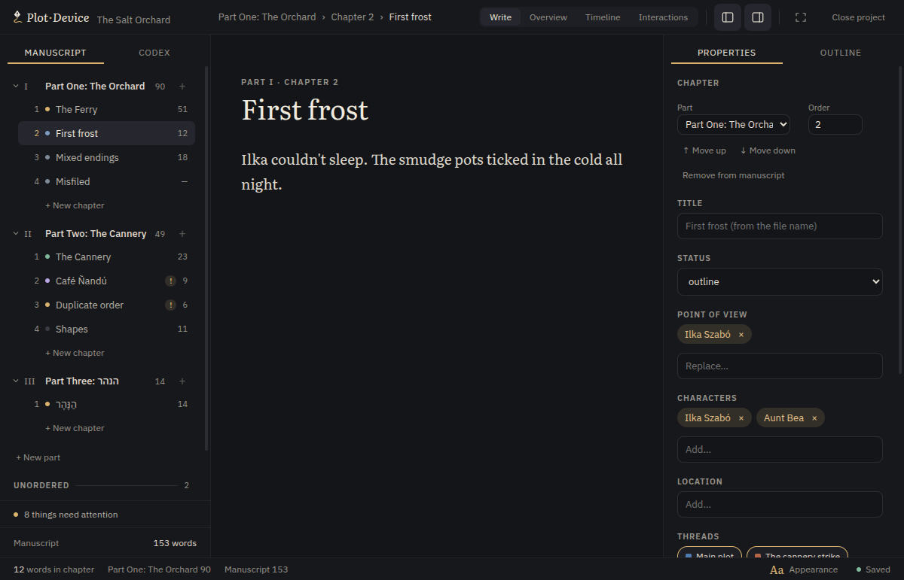
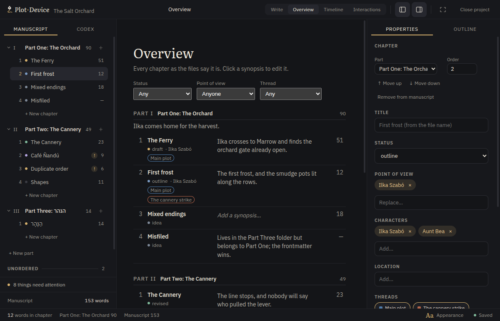

# Plot Device

> Write the novel. Keep the files.

[](https://github.com/mooeypoo/plotdevice/actions/workflows/ci.yml)
[](LICENSE)


Plot Device is a local writing and story-planning app for novelists. Your project stays a folder of plain Markdown files: open it in Plot Device, Obsidian, Git, or any text editor. There is no database or lock-in. It runs on Linux and Windows, with support for English, Hebrew, and other writing systems.

| Write in the chapter editor | See the story take shape |
| --- | --- |
|  |  |

Screenshots use the bundled sample novel.

## For writers

- **Write and organize:** keep chapters in parts, track their status and word count, and work from a focused editor.
- **Know your story:** collect characters, locations, and notes; track point of view, appearances, and plot threads.
- **See the shape:** browse a chapter overview and story timeline, with warnings for files or metadata that need attention.
- **Keep ownership:** your folder is the source of truth. Plot Device preserves the rest of each file when it updates its own metadata, and leaves files it cannot safely parse untouched.

### Get Plot Device

Download an installer from [Releases](https://github.com/mooeypoo/plotdevice/releases). If a prebuilt release is not available yet, see [Run from source](#for-developers).

- **Ubuntu and Debian:** install the `.deb` with `sudo apt install ./plotdevice_<version>_amd64.deb`. On Ubuntu 24.04 and later, use the `.deb` for its required app sandbox setup.
- **Other Linux:** make the AppImage executable with `chmod +x plotdevice-<version>.AppImage`, then run it. On Ubuntu 24.04 and later, see the [AppImage note](docs/development.md#the-appimage-wont-start-on-ubuntu-2404).
- **Windows:** run `plotdevice-<version>-setup.exe`. The installer is not signed yet, so Windows may ask you to confirm that you want to run it.

Open a project with **Open folder…**, or launch it from a terminal:

```bash
plotdevice ~/novels/my-novel
```

A project is a folder containing `novel.md` and Markdown entries. The [file format](docs/file-format.md) explains how it works and how to use it without Plot Device.

## For developers

Plot Device is built with Electron, Vue 3, and TypeScript. The main process owns file access; the renderer uses a typed API. Read the [architecture](docs/architecture.md) before changing those boundaries.

Requires Node.js 22.22.2 or newer and npm. Linux and Windows are supported; CI checks both.

```bash
npm ci
npm run dev
```

Run the project checks and build:

```bash
npm run lint
npm run typecheck
npm run test
npx electron-vite build
```

See [Development](docs/development.md) for packaging, troubleshooting, and Windows testing; the [roadmap](docs/roadmap.md) describes planned work.

The writer's manual is being prepared for GitHub Pages. Preview it locally with
`npm run docs:dev`, or run `npm run docs:build && npm run docs:preview` to check the
production site at `/plotdevice/`. It is not publicly deployed yet.

## Credits and license

Created by [Moriel Schottlender](https://moriel.tech). Plot Device is licensed under [GPL-3.0-or-later](LICENSE).
