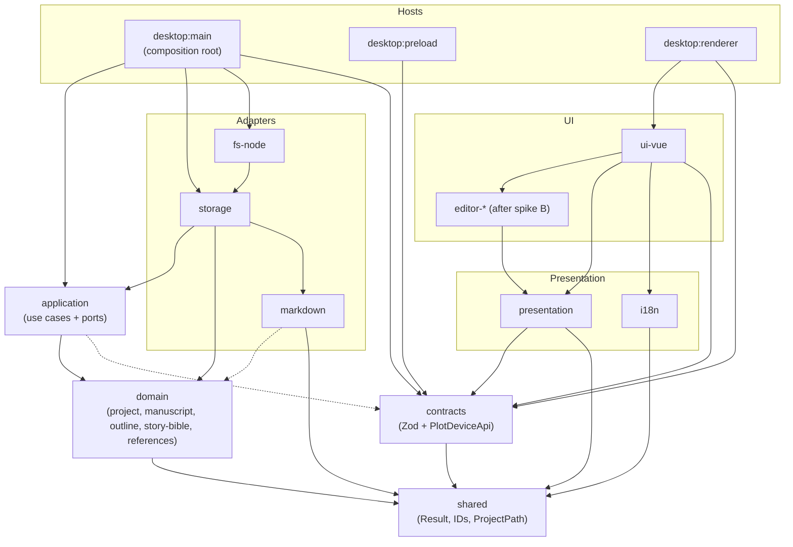

# Phase 0 Architecture Proposal

Status: **Architecture approved in principle (2026-10-25).** Revision 2 records the owner's decisions after the independent review. No code has been scaffolded or installed. Spike A starts only after the owner approves §13.
Date: 2026-10-25 (rev. 2)
Inputs: `AGENTS.md`, `CLAUDE.md`, `README.md`, `docs/PRD.md`, `docs/UX_SPEC.md`, `docs/DOMAIN_AND_FILE_FORMAT.md`, `docs/ARCHITECTURE.md`, `docs/DESIGN_SYSTEM.md`, `docs/IMPLEMENTATION_PLAN.md`, `docs/LEGACY_REPOSITORY_AUDIT.md`, `docs/COPY_FROM_LEGACY.md`, `assets/brand/`.

## How to read this document

Every substantive statement carries one of four labels:

| Label | Meaning |
|---|---|
| **[Agreed]** | Stated in `AGENTS.md` or the specs listed above. The source is cited. |
| **[Decided]** | An explicit owner decision made on 2026-10-25, after the review. It outranks the specs where they conflict (`AGENTS.md`, "Priority of authority"). |
| **[Rec]** | The author's recommendation. It is not binding until approved or recorded in an ADR. |
| **[Open]** | Unresolved. It needs a product decision, a spike result, or further design. Items the original proposal did not cover are marked **[Open: not covered]**. Open items not tied to a spike are deferred until the milestone that needs them. |

### Revision 2 changes

1. **Q1 resolved.** The new specs take precedence over all decisions made for the old app. It is no longer a blocker.
2. **Phase 0 is only the three spikes.** The walking skeleton moves to the first milestone after Phase 0 (§12).
3. **Spike B is broader:**
   - It evaluates a wider set of formatting: paragraphs, headings, bold, italic, block quotes, links, lists and scene breaks.
   - It covers paragraph-level RTL/LTR behavior and keyboard interaction in mixed-direction text.
   - Per-paragraph direction overrides are back under evaluation.
   - "Protected raw text" is now one candidate for unsupported content, judged on both preservation and writer UX.
4. **Spike A** now defines its offset units (UTF-16 internally, bytes checked at the I/O boundary), adds Hebrew, niqqud and emoji tests, and refines the preservation invariants. Legitimate renames, re-indentation and structural edits no longer count as failures.
5. **Spike C** adds per-file serialization and coalescing of writes, and requires that save status reflect only accepted, durable revisions. It also tests interruption and recovery of the multi-file journal.
6. **The Write milestone's acceptance criteria now include** autosave serialization and coalescing, stale-revision protection, and a save status that reflects durable revisions (§12.3).
7. **A human-readable manuscript table of contents is required.** The manifest alone is not enough. The choice between `CONTENTS.md` and a managed section in `project.md` is made before the milestone that implements it.
8. **Decided:**
   - Parts are optional groupings, with no Part documents in the MVP.
   - Hebrew UI wording is natural and gender-neutral.
   - The project-local folder, if one is needed, is `.plotdevice/`.
   - Changing a chapter's title never renames its file.
   - Development builds keep an identity and settings separate from the old installed app.
   - `DESIGN_SYSTEM.md` is the authority for design tokens, backed by contrast tests.
   - The license is an owner decision, and it does not block the spikes.
9. **The ADRs are consolidated from 22 into 8** (§11).
10. **Testing policy:** a pointer to the new `AGENTS.md` section, "Testing and quality requirements".
11. **New §13:** the execution plan for Spike A.

---

## 1. Executive summary

- **[Agreed]** Plot Device is being rebuilt from scratch ("clean room"). It is a local-first writing studio for fiction authors, backed by plain Markdown. It has two workspaces, **Story** (a working name) and **Write**. Chapters are the unit of the manuscript. Order comes from a manifest in `project.md`. Outlines are independent Markdown files with several views (Board, Outline, Cards). The UI is in English and Hebrew, with RTL support. Light, dark and system themes are provided (`AGENTS.md`, `PRD.md`).
- **[Decided]** Chapters are the required manuscript files. Outlines are independent Markdown hierarchies. There are no scene entities and no scene files.
- **[Decided]** A finished project must be understandable outside Plot Device without reading YAML or internal IDs. That requires a human-readable table of contents.
- **[Rec]** A pnpm monorepo arranged as a hexagon:
  - A pure domain and application core runs in Electron's main process now. The same core can later run in a web worker or a mobile webview.
  - Markdown codecs are pure string-to-model functions, separate from file access.
  - The renderer is a sandboxed Vue app. It talks to the core only through a Zod-validated contract.
- **[Rec]** Architectural boundaries are enforced in three independent layers:
  1. TypeScript project references, with restricted `lib` and `types` per package.
  2. dependency-cruiser rules.
  3. pnpm's strict `node_modules`.

  Deliberate violation fixtures prove that the rules actually fail when broken.
- **[Agreed]** Phase 0 consists of three isolated, throwaway spikes. Each one documents its conclusions, and spike code never becomes production code automatically:
  - A. Outline parsing, transformation and round-tripping
  - B. Tiptap vs. CodeMirror: writing UX, Markdown fidelity, RTL, accessibility
  - C. Manifest preservation, safe writes, revision checking and recovery
- **Blockers:** no product decision blocks Spike A. It needs only approval of its plan and its development dependencies (§13). The license is decided separately and blocks nothing in Phase 0.

---

## 2. Repository findings

- **[Agreed]** Commit `133ae0a` removed the old implementation. The repo contains docs, `assets/brand/`, and empty `tests/fixtures/legacy/` and `docs/adr/` folders.
- **[Agreed]** `assets/brand/` holds two SVG masters (`icon.svg`, `icon-small.svg`) and PNGs from 16 to 512 px. These assets are approved for reuse.
- **Gap:** `assets/brand/SOURCES.md` is missing. README step 3 requires it.
- **Gap:** there is no `.ico` file, and the Windows installer needs one. **[Rec]** Generate it from the 256 px PNG.
- **Gap:** there is no `.gitattributes`. On a Windows checkout with `core.autocrlf`, Git could rewrite line endings in the CRLF and LF fixtures. **[Rec]** Add `tests/fixtures/** -text` before committing fixtures (§13).
- **[Decided]** `LICENSE` was deleted in `133ae0a`. The license is an explicit owner decision. It does not block the isolated spikes, and is needed before any package is published or distributed.
- **[Agreed]** No legacy fixtures were copied. **[Rec]** New fixtures use invented sample content: *The Salt Orchard* sample cast, or the spec's own examples. Material from the author's private manuscript is never used.

---

## 3. Proposed monorepo and package structure

**[Agreed]** The layer split comes from `ARCHITECTURE.md`: domain, application, infrastructure, presentation, UI, platform. Its suggested layout is the starting point. Microservice ceremony and needless factories or interfaces should be avoided (`AGENTS.md`).

**[Rec]** The tooling is pnpm workspaces with TypeScript project references. The package list:

```
apps/
  desktop/                      Electron host (electron-vite + electron-builder)
    src/main/                   composition root: wires fs-node → storage → application → IPC
    src/preload/                exposes window.plotDevice (contracts only)
    src/renderer/               bootstraps ui-vue with the IPC client
packages/
  shared/        Result, branded IDs, ProjectPath (POSIX-style, pure). Kept tiny.
  domain/        project/ manuscript/ outline/ story-bible/ references/  (folders = contexts)
  application/   use cases per context; ports: ManifestRepository, ChapterRepository,
                 OutlineRepository, ReferenceRepository, Clock, IdGenerator, Trash
  contracts/     Zod schemas + PlotDeviceApi (commands, queries, events): the published language
  markdown/      pure string↔model codecs: frontmatter splitting, YAML Document patching,
                 mdast parsing with source offsets, targeted text splicing. Never stringifies whole docs.
  storage/       repository implementations (markdown + FileStore port, revisions, journal)
  fs-node/       FileStore for Node: atomic write, Windows retry, path validation, symlinks, watcher
  presentation/  framework-free view models: Board/Outline/Cards projections, navigator,
                 logical move semantics (start/end in RTL), ChapterEditorAdapter interface
  i18n/          translate(key, params, locale) facade, en.json / he.json, locale→direction
  ui-vue/        tokens (CSS custom properties), primitives, workspace components, composables, Pinia
  editor-*/      after spike B: the single chosen editor implementation of ChapterEditorAdapter
spikes/          throwaway, outside the workspace, never imported (lives on spike branches)
tooling/         tsconfig.base, eslint, dependency-cruiser config, architecture tests
tests/fixtures/  shared corpus (Salt Orchard; EN/HE/mixed/CRLF/BOM/malformed…)
```

How this differs from the layout suggested in `ARCHITECTURE.md`, and why (all **[Rec]**):

- **One `domain` package with a folder per context**, instead of a package per context. Context isolation is enforced by dependency-cruiser. This keeps the separation without the overhead of publishing many packages.
- **`markdown-storage` is split into `markdown` and `storage`.** `markdown` has no I/O, so it can run in any host, including the renderer for previews. `storage` depends on an abstract `FileStore` port, so web and mobile hosts can reuse it.
- **`filesystem-node` is renamed `fs-node`.** It implements `FileStore`.
- **`transport-contracts` is renamed `contracts`.**
- **The design tokens live inside `ui-vue`** at first, not in a separate package.
- **Future hosts** would be `apps/web` and `apps/mobile`. **[Open: not covered]** No design work has been done on them beyond keeping the ports host-neutral.

**[Open: not covered]** These are deferred to the first milestone after Phase 0:

- Exact npm package names and scope. `@plotdevice/*` is assumed.
- Node and Electron versions.
- Lockfile policy.
- Whether internal packages compile to `dist/` or are consumed as source through TypeScript paths.

---

## 4. Dependency boundaries

### 4.1 Rules

**[Agreed]** (`AGENTS.md`, `ARCHITECTURE.md`):

- The domain imports no Electron, Vue, Node, filesystem, Markdown parser, IPC, UI library or translation framework.
- The application imports the domain and port definitions, never infrastructure.
- Infrastructure implements the ports.
- Presentation builds view models and does no parsing or storage.
- Vue never uses `fs`.
- The preload script exposes a narrow, typed, validated API.
- The rules are enforced by TypeScript project references and dependency-cruiser in CI. Exceptions require an ADR.

**[Rec]** Rules for each package:

| Package | May import | Must not import |
|---|---|---|
| `shared` | none | anything |
| `domain` | `shared` | any npm package, `node:*` |
| `application` | `domain`, `shared`, `contracts` (types only) | `node:*`, vue, electron, yaml, mdast |
| `contracts` | `shared`, zod | other internal packages |
| `markdown` | `shared`, `domain` (types), yaml, micromark/mdast | `node:*`, I/O |
| `storage` | `application` (ports), `domain`, `markdown`, `shared` | `node:*` |
| `fs-node` | `storage` (FileStore port), `shared`, `node:*`, write-file-atomic, chokidar | vue, electron renderer |
| `presentation` | `contracts`, `shared` | vue, `application`, `domain` |
| `i18n` | `shared`, banana-i18n | vue |
| `ui-vue`, `editor-*` | `presentation`, `contracts`, `i18n`, `shared`, vue, pinia, editor libraries | `application`, `domain`, `storage`, `markdown`, `node:*`, electron |
| `desktop:main` | everything except `ui-vue`, `editor-*` | none |
| `desktop:preload` | `contracts`, electron (`contextBridge`, `ipcRenderer`) | everything else |
| `desktop:renderer` | `ui-vue`, `contracts` | `node:*`, electron |

Additional rules:

- **[Rec]** Inside `domain`, one context may import another only through that context's `index.ts`.
- **[Open]** Whether `markdown` may import `domain` types, or should return its own intermediate model for `storage` to map. Spike A informs this: its parser returns a standalone model.

### 4.2 Enforcement (**[Rec]**)

1. **TypeScript project references.** Each package is `composite` and references only the packages it is allowed to use. `domain`, `application`, `markdown` and `storage` compile with `"lib": ["ES2022"], "types": []`. Any use of `process`, `Buffer`, `document` or `fs` becomes a compile error.
2. **dependency-cruiser.** Its config mirrors §4.1. A Vitest architecture test runs it against deliberate-violation fixtures in `tooling/` and asserts that each one fails.
3. **pnpm's strict `node_modules`.** A package can only import what it declares in its own `package.json`.

### 4.3 Diagram

An arrow means "may import". Type-only imports are dashed.



---

## 5. Domain and application architecture

### 5.1 Bounded contexts

**[Agreed]** (`AGENTS.md`, `ARCHITECTURE.md`, `DOMAIN_AND_FILE_FORMAT.md`):

- The contexts are Project/Manifest, Manuscript, Outline, Story Bible, (Cross) References, Workspace Preferences, and Export/Publishing Projection.
- The vocabulary is Project, Manuscript, Chapter, Part, Outline, OutlineSection, OutlineItem, Character, Place, Note, and Links.
- **A chapter is not made of scenes.** `* * *` is formatting only.
- **An outline item is not a scene or a chapter.**
- **Links are explicit**, never inferred from titles.

**[Decided]**:

- Chapters are the required manuscript documents.
- No scene entities or scene files are introduced.
- Parts are optional groupings of chapters. There are no Part Markdown documents in the MVP.

**[Rec]**:

- Workspace Preferences and Export are thin and live mostly in `application` or `presentation`. Neither gets its own rich domain model in the MVP.

**[Open: not covered]** Deferred to Gate 2:

- The aggregate boundaries and invariants for each context, for example whether `Manuscript` is the aggregate that owns ordering and part membership.
- A domain event model, and whether one is needed at all.
- The Story Bible model beyond "title, description, expandable details" (`UX_SPEC.md`).

### 5.2 Application layer

**[Agreed]** The application owns commands, queries, ports and transaction boundaries. Example pathways are `MoveOutlineItem`, `MoveChapter` and `OpenReference` (`ARCHITECTURE.md`).

**[Decided]** (new requirements):

- **Writes to the same file are serialized or safely coalesced.** Two concurrent autosaves can never race.
- **A stale save never overwrites a newer edit**, whether that edit came from the app or from outside it.
- **Save-status indicators reflect only accepted, durable revisions.** "Saved" means the new bytes are on disk under a known revision, not that a write was queued.

**[Rec]**:

- **Ports:**
  - `ManifestRepository`, `ChapterRepository`, `OutlineRepository`, `ReferenceRepository`, which work in domain terms.
  - `Clock`, `IdGenerator`, `Trash`.

  `IdGenerator` keeps random ID generation out of the pure domain.
- **Where it runs:** application and infrastructure run in Electron's main process. The renderer calls typed commands and queries over IPC.
- **Other hosts:** the same core runs over an in-process transport in tests, in a web worker on the web, and in a Capacitor webview on mobile.
- **Revisions:** every write command carries an `expectedRevision`.
- **Write queue:** a per-file write queue in the core. While a write is in flight, newer content replaces any pending (unstarted) write. The next write's `expectedRevision` is the revision the previous write produced. Spike C validates this.
- **Outline undo:** structural undo restores the previous outline text under the same revision check.

**[Open: not covered]** Deferred to Gate 2 or 3:

- How the core pushes events to the renderer, for example external file changes or save status.
- Autosave cadence (debounce interval, saving when focus leaves).

---

## 6. Markdown persistence strategy

### 6.1 Agreed constraints

**[Agreed]** (`AGENTS.md`, `DOMAIN_AND_FILE_FORMAT.md`, `ARCHITECTURE.md`):

- **Files:**
  - One Markdown file per chapter in `manuscript/`. Outlines live in `outlines/*.md`. Characters, places and notes live in their own folders.
  - `project.md` frontmatter holds the manifest, which is the authority for order.
- **Preservation:**
  - Unknown frontmatter keys, key order, comments, the body, the BOM, line endings and unsupported Markdown are all preserved.
  - Loading and saving with no changes produces identical bytes.
  - Patches are targeted; files are not regenerated wholesale.
- **Write safety:**
  - Writes are refused if the file has changed since it was read (compare-before-write), and are atomic.
  - Content that fails to parse never triggers a "repair" write without the user's approval.
- **Watching:** file watcher events are hints only.
- **Paths:**
  - Paths are normalized to `/` and checked for case collisions, Windows reserved names, `..` escapes and symlink escapes.
- **Rendering:** project content is never rendered as HTML.
- **Schema changes:** every schema change needs a migration, a backup and fixtures.

**[Decided]**:

- **The new specs take precedence over every decision made for the old app.** The manifest decides order; frontmatter order fields from the old app are not used.
- **Filenames never change automatically** when a chapter's title changes. Renaming a file is an explicit action.
- **Unsupported content is never silently discarded.**
- **Human-readable portability.** Someone who never runs Plot Device must be able to understand the finished project without reading YAML or internal IDs. The machine-readable manifest alone does not meet this.
- **A table of contents is required.** It is accessible, human-readable and in reading order. Choosing between a generated `CONTENTS.md` and a managed Markdown section of `project.md` must happen before the milestone that implements the manifest (Gate 2).
- **The project-local folder, if one is needed, is `.plotdevice/`.** This replaces `.plot-device/` in `DOMAIN_AND_FILE_FORMAT.md`. Whether a project-local folder is needed at all is deferred.

### 6.2 Recommendations

**[Rec]**:

- **Codec approach:**
  - `markdown` parses with micromark/mdast to get source offsets and **never stringifies whole documents**. remark-stringify normalizes formatting, so it's avoided.
  - Edits are text splices on the original source.
  - Frontmatter is patched with the `yaml` Document API, using a custom fence splitter that handles a BOM, CRLF, and empty frontmatter.
- **Source offsets (units):**
  - Internally, offsets are JavaScript UTF-16 code-unit offsets into the decoded text, with the BOM removed. These are the units mdast's `position.offset` already uses.
  - Bytes appear only at the I/O boundary. There, the file is decoded as strict UTF-8, a leading BOM is recorded and removed, and re-encoding must reproduce the original bytes exactly.
  - Invalid UTF-8 makes the file read-only and shows a warning.
  - Splices may never split a surrogate pair (emoji) or separate a base letter from its combining marks (Hebrew niqqud).
- **Outline editing:**
  - The parser produces sections, an item tree, and preserved "opaque" blocks.
  - It also produces a map from each item to its source range. Item handles are ephemeral: valid only for one revision.
  - The domain decides the structural change. `storage` turns it into a splice and re-indents the moved subtree.
- **Revisions:**
  - A revision is the SHA-256 of the file's bytes. Size and modification time serve as a quick pre-check.
  - The watcher tells the app's own writes apart by comparing revisions, not by timing.
- **Line endings:** the existing ending is detected and preserved. New files use LF.
- **Scene breaks:** they are always written as `* * *` preceded by a blank line. A `---` under a paragraph would turn it into a setext heading.
- **Manifest entries** store both `id` and `file`, and the `id` is repeated in the chapter's frontmatter. This lets the app relink a file after it has been moved outside the app. **[Open]** Decided in the project-format ADR before Gate 2.
- **Deleting a chapter** moves it to the OS trash, through the `Trash` port.
- **File names** are compared after Unicode NFC normalization and case-folding.

The previous recommendation to have no contents list in the MVP is withdrawn. The [Decided] item above replaces it.

### 6.3 Unresolved

**[Open]**:

- The chapter id↔path mapping. The spec deliberately leaves it open (`DOMAIN_AND_FILE_FORMAT.md`). Before Gate 2.
- The table of contents: `CONTENTS.md`, or a managed section of `project.md`. Before Gate 2.
- The YAML shape of optional parts in the manifest, and whether chapter numbering restarts per part. Before Gate 2.
- The exact rules for discovering files. The old app's rule that `type` decides what a file is no longer applies. The rules follow the new specs' folder layout and are settled before Gate 2.
- What happens to files in `manuscript/` that aren't in the manifest, and to manifest entries whose files are missing. Before Gate 2.
- Outline content that isn't a heading or a bullet (spike A):
  - section intro paragraphs
  - bullets before any `##`
  - `###` headings
  - task lists and numbered lists
  - list items with several paragraphs
- Outline item IDs and how they're encoded (spike A).
- The link syntax from cards and references to chapters: relative Markdown links, `[[wikilinks]]`, or IDs (spike A).
- How unsupported content is presented to writers in the editor and the outline views (spikes A and B; see §9).
- Where backups and recovery copies live: OS app data, or `.plotdevice/` (spike C).
- **[Open: not covered]**:
  - The format of the multi-file transaction journal, and where it lives (spike C).
  - The backup retention policy (Gate 6).
  - The schema migration mechanism (Gate 6).

---

## 7. Electron/Vue separation

**[Agreed]** (`AGENTS.md`, `ARCHITECTURE.md`):

- Electron's main process is the privileged host.
- The renderer is sandboxed, with context isolation and a restrictive CSP.
- The preload script exposes narrow, typed, validated IPC.
- Vue does not use `fs`.
- Opening references and changing themes or layouts must not remount the editor.

**[Decided]** Development builds use an app identity and settings folder separate from the old installed app, so the two cannot share settings. **[Rec]** `appId: tech.moriel.plotdevice.dev`, with the settings folder `plotdevice-dev`. **[Open]** The production identity and the upgrade path from the old app are decided at the packaging milestone (Gate 6).

**[Rec]**:

- **`BrowserWindow` settings:** `contextIsolation: true`, `sandbox: true`, `nodeIntegration: false`, and web security left on.
- **Navigation:**
  - `will-navigate` is denied.
  - `setWindowOpenHandler` denies new windows.
  - External links open through `shell.openExternal` with an allowlist.
- **IPC:**
  - Every handler validates its input with Zod and checks the sender frame.
  - The preload script exposes only `window.plotDevice: PlotDeviceApi`, defined in `contracts`.
- **CSP:**
  - `style-src` uses a nonce rather than `'unsafe-inline'`, because both editors inject `<style>` elements.
  - CodeMirror supports a nonce through `EditorView.cspNonce`. Tiptap's equivalent is unverified, so spike B checks it.
- **Rendering:** no `v-html`. Untrusted Markdown is rendered from its mdast tree into components.
- **Component split:** Vue components only present. UI logic lives in composables. Domain logic lives behind the contract.
- **Editor:**
  - A `ChapterEditorAdapter` interface is defined in `presentation`.
  - `ARCHITECTURE.md` lists its operations: open, edit, selection, focus, dirty state, undo and redo, save.
  - It is implemented by exactly one `editor-*` package after spike B.
- **Old toolkit packages:** none of the old `@electron-toolkit/*` packages will be used. This follows an earlier user decision.

**[Open: not covered]** Deferred to Gate 3:

- How Pinia stores are organized and how they cache query results.
- How the renderer subscribes to push events from main.
- How windows are managed: one project per window, or several.
- The end-to-end test tool. Playwright for Electron is the likely candidate, but it is not on any list.

---

## 8. Internationalization, RTL, and theming

### 8.1 Localization and direction

**[Agreed]** (`AGENTS.md`, `PRD.md` §7, `UX_SPEC.md`, `ARCHITECTURE.md`):

- **Catalogs:**
  - English and Hebrew catalogs, both usable from the first release.
  - Banana-style keyed JSON with placeholders, CLDR plural and gender rules, and fallbacks.
  - No gettext or POT files.
- **Separate settings:** UI locale, UI direction, project language and the direction of each text block are distinct settings.
- **CSS and labels:**
  - CSS uses logical properties.
  - User-supplied labels are isolated with `dir=auto` and `<bdi>`.
  - No directional control characters are injected into content.
  - Nothing is mirrored by blanket rules.
- **Keyboard:** drag-and-drop has keyboard alternatives. In RTL, "start" and "end" follow the UI direction.
- **Direction controls:** each writing block can be set to auto, LTR or RTL "where supported" (`UX_SPEC.md`).

**[Decided]** The default Hebrew UI wording is natural and gender-neutral (for example "יש לבחור פרק" rather than "בחר/בחרי פרק").

**[Rec]**:

- **Library:** use `banana-i18n` behind a `translate(key, params, locale)` facade in `i18n`. The Vue plugin wrapper lives in `ui-vue`.
- **Locale switching:** changing the locale sets `lang` and `dir` on `<html>` without reloading the page.

**[Open]** Prose paragraph direction is evaluated in spike B, and overrides are not ruled out in advance. The candidates:

1. The project language sets the base direction, and auto-detection applies only when a paragraph has no strong characters. This stores nothing in the files.
2. Per-paragraph auto-detection (first strong character).
3. (1) or (2), plus per-paragraph overrides stored in the Markdown. Spike B evaluates how each encoding looks in other editors.

**[Risk]** First-strong-character detection gets lines like `Daniel אמר: "שלום".` wrong in Hebrew books, because the line starts with an English letter.

**[Open: not covered]** Deferred to Gate 3:

- Where translation catalogs live: one file per locale, or one per package.
- A glossary or terminology policy for the new app.
- A test that blocks retired or untranslated keys.

### 8.2 Theming

**[Agreed]** (`PRD.md` §8, `DESIGN_SYSTEM.md`, `UX_SPEC.md`):

- Themes are system (the default), light and dark.
- The theme is stored in OS app data.
- Semantic tokens are CSS custom properties.
- Color is never the only signal.
- The motion design respects reduced-motion settings.
- Switching themes never remounts the editor.
- Write is visually quieter than Story.

**[Decided]** `DESIGN_SYSTEM.md` is the authority for design tokens. Where `UX_SPEC.md` disagrees, `DESIGN_SYSTEM.md` wins. The tokens are backed by automated accessibility and contrast tests.

**Inconsistencies this resolves (for the record):**

- Dark paper is `#242A34` in UX_SPEC and `#222831` in DESIGN_SYSTEM.
- Light paper is `#FFFFFF` in UX_SPEC and `#FFFDF8` in DESIGN_SYSTEM.
- The name sets differ: canvas/paper/surface vs. app background/card/prose page.

**[Open]** Warning and focus colors exist only in `UX_SPEC.md`. They need adding to `DESIGN_SYSTEM.md` before Gate 3.

**[Open]** The brand icon is charcoal, cream and gold (`#d8b26e`), while the proposed accent is teal. Not a blocker.

**Measured contrast (WCAG 2.1)** for the values in both specs. In the light theme, several pairs fail AA (4.5:1) for normal text. The dark theme passes:

| Pair | Ratio |
|---|---|
| Light secondary `#677480` on canvas `#F7F5F1` | 4.40 |
| Light secondary on surface `#EFEEE9` | 4.12 |
| Light teal `#288C89` text on white | 4.04 |
| White text on a teal button | 4.04 |
| Light amber `#C48D50` on a card | 2.89 |
| Paper against canvas (light and dark) | about 1.1 |
| Dark secondary on canvas | 7.64 |
| Dark teal on paper | 7.10 |

**[Rec]**:

- Darken light teal to about `#1F7A77` and light secondary text to about `#5E6A75`.
- Give the edge of the paper a border or shadow.

The contrast tests will flag these values until `DESIGN_SYSTEM.md` is updated.

**[Open]** The final palette and accent.

---

## 9. Proposed proof-of-concept experiments

**[Agreed]** There are three throwaway spikes: outline round-trip, editor selection, and safe manifest writes (`AGENTS.md`; `IMPLEMENTATION_PLAN.md` Gate 1). A spike must not become production architecture by default.

**[Decided]** Phase 0 is only these three spikes. Each is isolated and documents its conclusions. Its experimental code is not promoted to production automatically.

**[Rec]**:

- Spikes live on `spike/*` branches, in `spikes/<name>/` as standalone packages outside any workspace.
- The only things merged to `main` are:
  - a findings note at `docs/spikes/<name>.md`
  - the fixtures
  - a draft ADR
- Spike code stays on its branch.
- Each spike lists its tests before coding and reports actual results, following `AGENTS.md`, "Testing and quality requirements".
- All three spikes can start independently.

### Spike A: outline parsing, transformation and round-trip

The full execution plan is in §13.

- **Corpus:** about 18 outline files covering:
  - English, Hebrew and mixed text, Hebrew with niqqud, and emoji
  - CRLF line endings, a BOM, no final newline
  - tabs vs. 2- or 4-space indents, and the `-`, `*` and `+` bullet markers
  - numbered lists, task lists and loose lists
  - section intro paragraphs, `###` headings, HTML comments
  - code blocks and tables inside items
  - empty sections, no `##` at all, and nesting six levels deep
  - frontmatter
- **Operations:**
  - Move an item with its children: within a section, between sections, into an empty section, to the end.
  - Rename an item while keeping its inline formatting.
  - Add a card or a detail.
  - Add or rename a section.
  - Delete, then undo.
- **ID encodings compared:**
  - Obsidian block IDs (`- text ^k3f9`)
  - HTML comments
  - `{#id}` attributes

  Each is checked for how it renders in Obsidian, GitHub and VS Code, and whether it survives moves.
- **Acceptance criteria** (revised):
  - **No-op:** load and save with no changes gives identical bytes for 100% of the corpus.
  - **Commutation:** for every operation, parsing the edited text gives the same model as applying the operation to the parsed model. This is the main correctness check.
  - **Locality:** every byte outside the regions the operation declares stays identical. The regions are the source range of the moved subtree and the insertion point, or the renamed text span. Re-indenting the moved lines is allowed inside those regions.
  - **Conservation, by operation:**

    | Operation | Expected change |
    |---|---|
    | Move | The multiset of item texts is unchanged, after stripping indentation and list markers |
    | Rename | Only the renamed item's text changes |
    | Add | Exactly one new item or section appears |
    | Delete | Exactly that subtree disappears |

  - **Opaque blocks:** every unsupported block appears exactly once after any operation, either with its owning item or in place.
  - **Reversibility:** where the indentation style is uniform, 1,000 seeded random moves followed by their reversals restore the original bytes. For files with mixed indentation, the moves and reversals must still re-parse to the original model, with the byte-level difference documented.
  - **Unicode:** offsets and splices are correct in Hebrew, mixed, niqqud and emoji fixtures, and no splice ever splits a surrogate pair or detaches a combining mark.
  - **Refusals:** an operation the parser cannot apply safely is refused with a reason code. It never produces a lossy result.
- **Writer UX (findings, not tests):** for each unsupported construct, how a writer would see it in Board, Outline and Cards. Options are a read-only card with an explanation, a "kept as written" block, or hiding it with a warning count. The recommendation goes to the Gate 4 design.
- **Insight:** scenario D (link a card to a chapter) only needs the chapter to have a stable ID, because the link is stored on the card. Card IDs may not be needed in the MVP.

### Spike B: Tiptap vs. CodeMirror 6

- **Setup:**
  - Two minimal Vue pages running in Electron's Chromium, tested on Linux and Windows.
  - The scoring rubric is written down before the spike starts.
- **Candidate formatting** ([Decided] that all are evaluated; any may be deferred after testing, based on evidence):
  - paragraphs, headings, bold, italic, block quotes, links, lists, and `* * *` scene breaks.

  For each feature the spike records: how a writer creates and removes it, how it looks, what Markdown it produces, and whether that Markdown round-trips.
- **Unsupported content** (footnotes, HTML, tables, anything else):
  - It is judged on preservation and on writer UX.
  - "Protected raw text" is one candidate. Others include a non-editable chip with an explanation, or showing the source text inline with gentle styling.
  - The requirement: nothing is silently discarded.
- **Fidelity:**
  - Load and save with no changes gives identical bytes.
  - Editing one paragraph changes only that paragraph. Tiptap needs a prototype that splices changed paragraphs into the original text.
  - `* * *` and both emphasis styles (`_x_` and `*x*`) are kept.
- **Pasting:** from Word, Google Docs, the web, and plain text. The result is cleaned to the supported formatting.
- **Paragraph direction (RTL/LTR):**
  - Each of the candidates in §8.1 is tried, including overrides.
  - With overrides, the spike records how a writer sets one, how it's stored in Markdown, and how that encoding looks in Obsidian, GitHub and VS Code.
  - Test cases:
    - `Daniel אמר: "שלום".` in a Hebrew project
    - a Hebrew paragraph inside an English chapter
    - an English quote inside a Hebrew paragraph
    - lists and block quotes in either direction
- **Keyboard in mixed-direction text:**
  - The arrow keys move visually, as the platform does.
  - Home/End.
  - Shift and Ctrl+Shift selection across runs of different direction.
  - Word-by-word movement.
  - Deleting at a direction boundary.
  - Numbers and punctuation (quotes, parentheses, the Hebrew maqaf) at run edges.
  - Input methods (IME), and switching keyboard layouts in the middle of a paragraph.
  - Each case is recorded per editor, on Linux and Windows.
- **Accessibility:**
  - Basic reading and navigation with Orca (Linux) and NVDA (Windows).
  - Complete keyboard use.
  - Formatting and direction are announced.
- **Performance:** typing delay and memory use on a 150,000-character chapter.
- **Stability:** switching the theme or moving the editor to another panel keeps the same instance and its undo history.
- **Writing feel:** how much Markdown syntax is visible. For CodeMirror this means live-preview decorations.
- **Spellcheck:** Hebrew and English at once, through Electron's spellchecker.
- **CSP:** each editor's nonce support is checked.
- **Hypothesis, not a conclusion:** CodeMirror wins on fidelity and Tiptap on writing feel. What decides it is whether CodeMirror's live preview is acceptable for writers, or whether paragraph splicing gets Tiptap to full fidelity.
- **[Open]** The rubric weights and the test chapters are proposed at the start of spike B.

### Spike C: manifest preservation, safe writes, revisions and recovery

- **Where it runs:** Vitest against real temporary folders, on Linux and on `windows-latest` in CI.
- **Manifest edits:**
  - Reordering by patching the YAML keeps comments, unknown keys and key order.
  - Moving a chapter between parts.
  - All other bytes stay identical.
- **Revisions:** stale writes are refused, based on the SHA-256 revision.
- **Serialized and coalesced writes (new):**
  - 100 rapid autosaves of one file produce at most one write in flight at any time.
  - The final file contains the last content.
  - Every write's expected revision equals the revision the previous write produced.
  - Intermediate content may be skipped (coalesced), but it is never written after newer content.
  - An external edit that lands between two queued writes makes the next write refuse as stale. It doesn't overwrite.
- **Durable save status (new):**
  - The "saved" status for revision R is reported only after the bytes for R are on disk and R has been recorded as the file's current revision.
  - A test injects a failure after the write but before the rename, and asserts that "saved" is never reported.
- **Crash safety:**
  - A child process is killed in the middle of a write. The file must end up either old or new, never partial or empty.
  - Windows: a file held open by another process gets retries with backoff, then a clear error.
  - A symlinked chapter is written through to its target, or the write is refused.
  - Read-only files produce a clear error.
- **Path checks:**
  - Case collisions, and Hebrew names in both NFC and NFD forms.
  - `CON` and trailing dots.
  - `../` paths and symlinks pointing outside the project.
- **Rename and relink journal:**
  - Renaming a chapter file updates the manifest and the links in outlines, through a journal.
  - The process is interrupted (killed) after each step and at each write inside a step.
  - On the next start, recovery either finishes the operation or rolls it back. The result is a consistent project: every manifest path resolves, and no links are broken by the operation.
  - Recovery is idempotent: running it twice gives the same result.
- **Own-write detection:** the watcher identifies the app's own writes by revision, not by timing.
- **To evaluate:** `write-file-atomic`, compared with a custom write (fsync the file, rename it, fsync the directory).
- **To evaluate:** where backups and the journal live, OS app data or `.plotdevice/`.

---

## 10. Risks, assumptions, and unresolved questions

### 10.1 Risks

- **[Risk]** Tiptap's Markdown serialization rewrites the whole file: emphasis markers, hard wraps, escaping, HTML, footnotes. Fidelity then depends on splicing changed paragraphs, which is unproven.
- **[Risk]** CodeMirror might feel too technical for writers if its live preview falls short (`ARCHITECTURE.md` raises the same concern).
- **[Risk]** Scene breaks normalized to `---` turn the preceding paragraph into a setext heading.
- **[Risk]** On Windows, the atomic rename fails with EPERM or EBUSY when antivirus, sync tools or Obsidian hold the file. Atomic replace also turns a symlink into a regular file.
- **[Risk]** Multi-file operations (renaming and relinking) are not atomic without a journal.
- **[Risk]** First-strong-character direction detection is wrong for Hebrew paragraphs that start with a Latin name.
- **[Risk]** Storing per-paragraph direction overrides in Markdown can clutter the file when it's opened in other editors.
- **[Risk]** Unicode normalization of file names (NFC vs. NFD, niqqud) and case-insensitive file systems.
- **[Risk]** Mixing up UTF-16 offsets and byte offsets corrupts splices in Hebrew and emoji text. Spike A covers this.
- **[Risk]** A large manifest in `project.md` frontmatter makes the file mostly YAML. Obsidian's properties panel displays nested lists of objects poorly. The required table of contents mitigates this for human readers.
- **[Risk]** The project `id` is copied when someone duplicates the folder. **[Rec]** Key per-user state on both the id and the path.

### 10.2 Assumptions

- Electron's main process is an acceptable home for the application core.
- Linux and Windows are the target desktop platforms. macOS is not mentioned in the new specs. **[Open: not covered]**

### 10.3 Decisions and remaining questions

**Resolved on 2026-10-25 ([Decided]):**

| # | Question | Decision |
|---|---|---|
| Q1 | Do the new specs replace the old app's decisions? | Yes, all of them. Not a blocker. |
| Q2 | Parts | Optional groupings, with no Part documents in the MVP. Numbering and the YAML shape remain **[Open]** until Gate 2. |
| Q3 | Prose formatting | Spike B evaluates paragraphs, headings, bold, italic, block quotes, links, lists and scene breaks. The final set follows UX evidence. Unsupported content is never silently discarded. |
| Q4 | Hebrew UI wording | Natural and gender-neutral by default. |
| Q5 | Paragraph direction | Evaluated in spike B, with overrides included (§8.1). |
| Q6 | Project-local folder | `.plotdevice/`, if needed. Backup location is evaluated in spike C. |
| Q7 | Continuity with the old app | Development identity and settings are kept separate from the old installed app. Production identity is decided at packaging. |
| Q8 | License | An explicit owner decision. It does not block the spikes. |
| (new) | Portability | A human-readable table of contents is required. It is either `CONTENTS.md` or a managed section of `project.md`, decided before Gate 2. |
| (new) | Filenames | They never change automatically when a title changes. |

**Still open, and deferred to the milestone that needs them:**

- Production dependency list: approved per milestone. Spike A's development dependencies are in §13.
- The public name for "Story".
- The final palette and accent.
- Outline card IDs (spike A).
- Optional filename sync as an explicit action (`DOMAIN_AND_FILE_FORMAT.md`, deferred).
- The compile format.
- Whether spellcheck, word count, find and replace, and project-wide search are in the MVP. The specs mention only "search reference catalog by title".
- Autosave cadence, and how conflicts are worded for nontechnical authors.

---

## 11. ADRs to record (consolidated)

**[Agreed]** ADRs are required for the schema, the editor, the ID strategy, storage transactions and portability compromises (`ARCHITECTURE.md`). Any exception to the dependency rules also needs one (`AGENTS.md`).

**[Decided]** ADRs record significant decisions and their rationale, not minor tooling preferences.

**[Rec]** Eight ADRs:

| ADR | Covers | When |
|---|---|---|
| 1. Foundation | Clean-room rebuild, legacy reuse policy, app identity (development separation, `.plotdevice/`), license (when decided) | Before Gate 2 |
| 2. Architecture and boundaries | Monorepo layout, layers, three enforcement layers, core in Electron main, Zod contract, rendering untrusted content, Electron security | Before Gate 2 |
| 3. Markdown fidelity and outline mapping | Byte-identical no-op, splicing, offset units, line endings and BOM, outline mapping and supported subset, outline IDs and link syntax | From spike A |
| 4. Editor | Editor choice, prose formatting set, unsupported-content UX, paragraph direction | From spike B |
| 5. Persistence safety | Revisions, atomic writes, Windows retries, symlinks, write serialization and coalescing, durable save status, multi-file journal, backups, watcher as hints | From spike C |
| 6. Project format | Manifest shape, id↔file mapping, optional parts, file discovery, unlisted and missing chapters, table of contents | Before Gate 2 |
| 7. Localization and theming | banana-i18n facade, Hebrew wording policy, design-token authority and contrast tests | Before Gate 3 |
| 8. Domain IDs | ID format and generation through `IdGenerator` | Before Gate 2, folded into ADR 6 if small |

---

## 12. Phase 0 tasks and acceptance criteria

**[Agreed]** Implementation is one approved milestone at a time. Each milestone lists its files, acceptance tests and open decisions, and gets human approval before any code changes (`AGENTS.md`). Each milestone states its testing requirements before coding and reports actual results before completion (`AGENTS.md`, "Testing and quality requirements").

### 12.1 Phase 0: three spikes

Each spike is approved separately. Spike A is first; its plan is in §13.

| Spike | Merged to `main` | Done when |
|---|---|---|
| A | `docs/spikes/outline.md`, `tests/fixtures/outlines/`, draft ADR 3 | Every acceptance criterion in §9 passes on the corpus, or failures are explained with a recommendation |
| B | `docs/spikes/editor.md`, `tests/fixtures/chapters/`, draft ADR 4 | A scored recommendation covering formatting, unsupported-content UX, paragraph direction, keyboard, accessibility, fidelity and performance |
| C | `docs/spikes/file-writes.md`, `tests/fixtures/projects/`, draft ADR 5 | Serialization, durable status, stale-write, crash, path and journal tests pass on Linux and Windows |

Supporting tasks, each done inside the spike that needs it:

- `.gitattributes` for fixtures (Spike A)
- `assets/brand/SOURCES.md` (any time; docs only)

### 12.2 First milestone after Phase 0: walking skeleton (moved out of Phase 0)

This is not part of Phase 0. It is listed here so the reviewer sees where it went. It is planned in detail after the spikes:

- Every package from §3, each with a README of 15 lines or fewer and at least one real test.
- All three enforcement layers, with violation fixtures that make CI fail.
- An Electron window with the security settings from §7 and a separate development identity.
- One query through the Zod contract.
- EN/HE switching, with `lang` and `dir`.
- System/light/dark tokens from `DESIGN_SYSTEM.md`, with contrast tests.
- A CI matrix for Linux and Windows.

**Commands [Rec]:**

```
pnpm lint
pnpm typecheck      # tsc -b + vue-tsc
pnpm test
pnpm arch           # dependency-cruiser + violation fixtures
pnpm build
```

### 12.3 Requirements carried to later milestones

- **Write milestone (Gate 3)** acceptance criteria include:
  - [ ] Autosaves of a chapter are serialized per file or safely coalesced. Rapid typing never produces two writes to one file at once, and never writes older content after newer content.
  - [ ] A stale save never overwrites newer on-disk content. The writer gets a conflict with recovery options (scenario G).
  - [ ] The save-status indicator shows "saved" only for accepted, durable revisions. A failed or pending write is shown as such.
- **Manifest milestone (Gate 2)** acceptance criteria include:
  - [ ] The table of contents (chosen format) shows the reading order in plain Markdown, with part and chapter titles and working links, and no IDs or YAML.
  - [ ] Changing a chapter title does not rename its file.

---

## 13. Spike A execution plan (awaiting approval)

### Scope

Parse outline Markdown into sections and items, with source ranges. Apply structural operations as text splices. Prove preservation and correctness on the fixture corpus.

Out of scope: UI, the file store, persistence safety, chapters, and the manifest.

### Isolation

- Branch `spike/outline-roundtrip`.
- Code in `spikes/outline/` as a standalone package, outside any workspace. It is never imported by production code.
- Only the fixtures, the findings note and the draft ADR are proposed for merging.

### Files

```
.gitattributes                         tests/fixtures/** -text  (prevents line-ending rewrites)
tests/fixtures/outlines/
  README.md                            what each fixture exercises
  basic-en.md                          ## sections, - cards, nested details
  basic-he.md                          the same, in Hebrew
  mixed-direction.md                   Hebrew and English in one item; numbers and quotes
  unicode-niqqud-emoji.md              niqqud, emoji (surrogate pairs), ZWJ sequences
  crlf.md                              CRLF line endings
  bom.md                               UTF-8 BOM
  no-final-newline.md
  indent-tabs.md
  indent-four-spaces.md
  mixed-markers.md                     -, *, + bullets
  ordered-and-task-lists.md            1. and - [ ] items
  loose-lists.md                       blank lines between items; continuation paragraphs
  section-intro-paragraphs.md          prose between ## and the first bullet
  preamble-and-h3.md                   content before the first ##; ### headings
  embedded-blocks.md                   code fence, table, HTML comment, block quote inside items
  empty-sections.md
  no-h2.md                             bullets with no section headings
  deep-nesting.md                      six levels deep
  frontmatter.md                       YAML frontmatter, including unknown keys and comments
spikes/outline/
  package.json                         private; dev dependencies only
  tsconfig.json                        strict, noUncheckedIndexedAccess, lib ES2022, types: []
  vitest.config.ts
  README.md                            how to run; what is throwaway
  src/source-text.ts                   strict UTF-8 decode, BOM and line-ending detection, exact re-encode
  src/outline-model.ts                 model types and model-level operations (the reference)
  src/parse-outline.ts                 mdast → model, plus a map from items to source ranges
  src/edit-outline.ts                  operations → text splices, re-indenting moved subtrees
  src/id-encodings.ts                  the three ID encodings, behind one interface
  test/roundtrip.test.ts               no-op byte identity across the corpus
  test/operations.test.ts              commutation, locality and conservation per operation
  test/random-moves.test.ts            seeded random moves and reversals; generated 2,000-card outline
  test/unicode-offsets.test.ts         Hebrew, niqqud, emoji; no split surrogates or detached marks
  test/unsupported.test.ts             opaque blocks preserved, or a refusal with a reason code
  test/id-encodings.test.ts            survival under moves and renames
docs/spikes/outline.md                 findings: supported subset, offset policy, ID encoding, UX notes, timings
docs/adr/0003-markdown-fidelity-and-outline-mapping.md   draft
```

All fixture content uses the invented *Salt Orchard* sample. Nothing comes from a real manuscript.

### Development dependencies (spike only; each tied to a requirement)

| Package | Why |
|---|---|
| `typescript` | Strict typing (`AGENTS.md`) |
| `vitest` | Test runner (`AGENTS.md`) |
| `micromark`, `mdast-util-from-markdown` | A CommonMark parser that reports source offsets, needed for splicing |
| `micromark-extension-gfm`, `mdast-util-gfm` | Recognizing task lists and tables, so they're preserved, not misread |
| `yaml` | Recognizing frontmatter in outlines without rewriting it |

There is no property-testing library: the random-move tests use a small seeded random number generator. No production dependency is added.

**Package manager:** pnpm 12.14 is installed locally. Using it for the spike matches the recommended monorepo tooling. npm 12 is the fallback.

### Commands

```
git switch -c spike/outline-roundtrip
cd spikes/outline
pnpm install
pnpm test            # vitest run
pnpm typecheck       # tsc --noEmit
```

### Reporting

`docs/spikes/outline.md` will contain:

- the result of each acceptance criterion, with the actual test output
- a table of supported and unsupported constructs
- the offset policy
- the ID-encoding comparison, with screenshots from Obsidian, GitHub and VS Code where useful
- notes on writer UX for unsupported content
- parse and move timings for the 2,000-card outline
- a recommendation on whether `markdown` returns domain types or its own model (§4.1)
